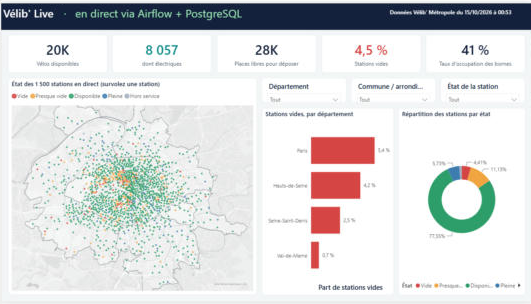
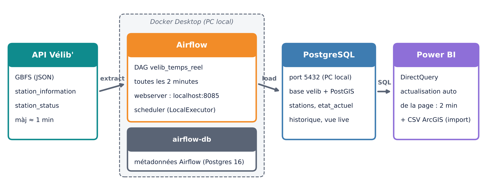
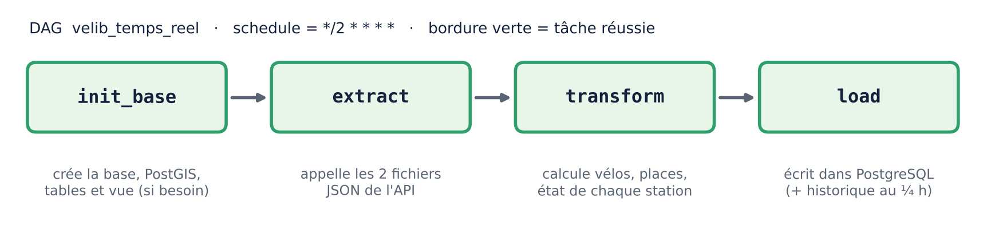
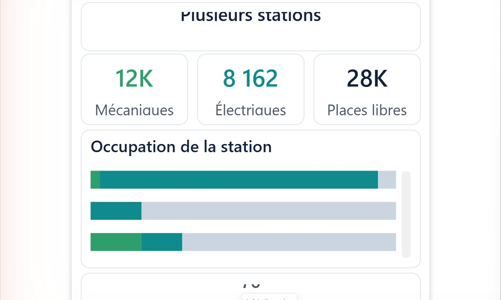

# Vélib' Live (v1) : pipeline temps réel Airflow → PostgreSQL/PostGIS → Power BI

Tableau de bord **en direct** des ~1 500 stations Vélib' Métropole (Paris et petite couronne).
Toutes les **2 minutes**, un DAG **Apache Airflow** (dans Docker) récupère l'API open data Vélib',
calcule l'état de chaque station et l'écrit dans **PostgreSQL + PostGIS**. **Power BI**, en
**DirectQuery**, lit ces données et rafraîchit sa page automatiquement.

Projet personnel de **géomaticien / data engineer** : orchestration, ETL Python, base spatiale et
restitution décisionnelle, avec une analyse SIG (ArcGIS Pro) de la couverture du réseau.



---

## Architecture



| Brique | Rôle |
|---|---|
| **API Vélib' (GBFS)** | `station_information` (référentiel) et `station_status` (vélos, bornes), mise à jour ≈ 1 min |
| **Airflow 2.10.5** (Docker, LocalExecutor) | DAG `velib_temps_reel`, planifié `*/2 * * * *` |
| **PostgreSQL 17 + PostGIS** (sur le PC) | tables `stations`, `etat_actuel`, `historique` et vue `v_stations_live` |
| **Power BI Desktop** (format PBIP) | modèle composite : DirectQuery sur la vue live et Import des indicateurs SIG (CSV) |

### Le DAG



`init_base → extract → transform → load`

- **init_base** crée la base, l'extension PostGIS et les tables si elles n'existent pas.
- **extract** appelle les deux flux GBFS.
- **transform** calcule vélos mécaniques et électriques, bornes libres et l'**état** de la station :
  Hors service, Vide (0 vélo), Presque vide (≤ 2), Pleine (0 borne) ou Disponible.
- **load** fait un *upsert* de `stations` et `etat_actuel`, puis ajoute à `historique` un relevé
  par **quart d'heure** (`ON CONFLICT DO NOTHING`, donc rejouable sans doublon).

Le DAG ne fait qu'**orchestrer** : tout le code métier est dans le package Python `velib_etl/`,
testable sans Airflow (`python -m velib_etl`). Réglages : `catchup=False`, `max_active_runs=1`,
1 relance après 30 s, timeout de 5 min.

---

## Arborescence

```
├── airflow/
│   ├── docker-compose.yml          # Airflow webserver + scheduler + base de métadonnées
│   ├── parametres.exemple.txt      # modèle à copier en parametres.txt (non versionné)
│   └── dags/
│       ├── velib_temps_reel.py     # le DAG (orchestration seulement)
│       └── velib_etl/              # l'ETL : config, extract, transform, load, schema
│           └── sql/schema.sql      # tables + vue v_stations_live
├── powerbi/
│   ├── Velib_Live.pbip             # projet Power BI (format texte PBIP / TMDL / PBIR)
│   ├── Velib_Live.SemanticModel/
│   ├── Velib_Live.Report/
│   └── donnees/                    # indicateurs SIG issus d'ArcGIS Pro (CSV, GeoJSON)
└── docs/images/                 # captures et schémas du README
```

---

## Démarrage rapide

### Prérequis

- **Docker Desktop**
- **PostgreSQL** (port 5432) avec l'extension **PostGIS** (sans PostGIS, le pipeline fonctionne quand même, sans colonne géométrique)
- **Power BI Desktop** (Windows)

### 1. Paramètres

```bash
cd airflow
cp parametres.exemple.txt parametres.txt     # Windows : copy parametres.exemple.txt parametres.txt
```

Remplir `parametres.txt` : mot de passe PostgreSQL, mot de passe de l'interface Airflow et clé
secrète. Ce fichier est exclu du dépôt par le `.gitignore`.

### 2. Lancer Airflow

```bash
docker compose up -d
```

- Interface : <http://localhost:8085> (utilisateur `admin`, mot de passe choisi à l'étape 1)
- Le DAG `velib_temps_reel` démarre tout seul et tourne toutes les 2 minutes.
- La base `velib` est créée au premier passage.

Vérification rapide dans PostgreSQL :

```sql
SELECT etat, count(*) FROM v_stations_live GROUP BY etat;
```

### 3. Ouvrir le rapport Power BI

1. Ouvrir `powerbi/Velib_Live.pbip`.
2. Dans *Transformer les données > Paramètres*, mettre dans **DossierDonnees** le chemin du dossier `powerbi/donnees/` sur ton poste (avec le `\` final).
3. Saisir les identifiants PostgreSQL quand Power BI les demande (`localhost:5432`, base `velib`).
4. L'actualisation automatique de la page est réglée sur **2 minutes**.

---

## Résultats

- **~1 500 stations** suivies en direct, environ 20 000 vélos, dont 8 000 électriques.
- Des indicateurs à jour toutes les 2 minutes : vélos disponibles, places libres, stations vides, taux d'occupation.
- Des filtres par département, commune et état, plus une infobulle par station (vélos mécaniques et électriques, bornes libres).
- Un **historique** au quart d'heure qui s'accumule dans PostgreSQL, base des futures analyses.
- Une page **Couverture** (analyse SIG ArcGIS Pro) : population à moins de 300 m d'une station, gares non desservies, propositions d'implantation.



---

## Évolutions envisagées (v2)

Cette **v1** repose sur Airflow, PostgreSQL et Power BI. Une **v2** est envisagée pour aller vers
une architecture *data engineering* plus complète :

- **Data lake MinIO** (stockage objet compatible S3) en architecture *médaillon* :
  - **bronze** : les réponses brutes de l'API, conservées telles quelles ;
  - **silver** : les données nettoyées et typées, au format Parquet ;
  - **gold** : des agrégats prêts à l'analyse (statistiques par station, jour et heure).
- **Contrôle qualité des données** avant chargement : complétude, validité, cohérence, fraîcheur, unicité, volumétrie. Les lots non conformes seraient mis en quarantaine et une page Power BI suivrait la qualité.
- **Données météo** horaires, pour expliquer l'usage des vélos.
- **Machine learning** : prévoir le nombre de vélos disponibles par station à **15 min – 2 h**, entraîné sur l'historique et la météo, après plusieurs semaines de collecte.

---

## Données et crédits

- Données temps réel : [Vélib' Métropole – open data](https://www.velib-metropole.fr/donnees-open-data-gbfs-du-service-velib-metropole) (format GBFS).
- Analyse de couverture : traitements ArcGIS Pro (population carroyée, gares, territoires).
- Réalisation : **Mawa Diaw**.
